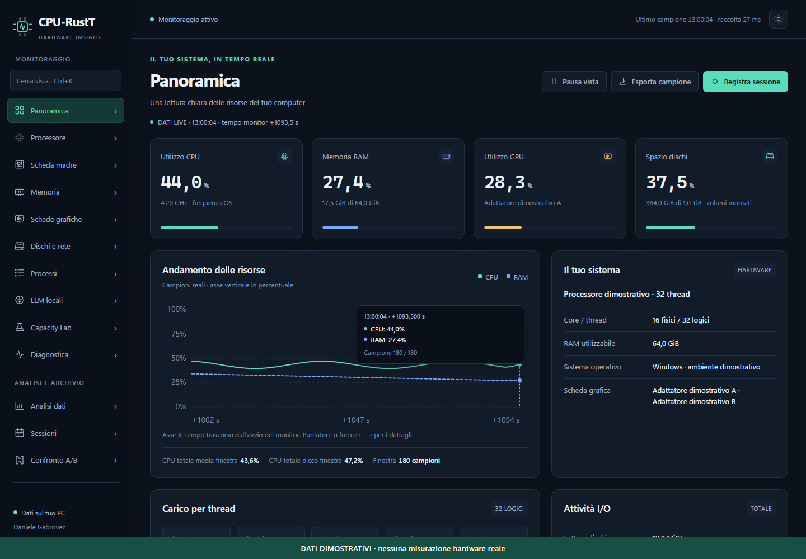
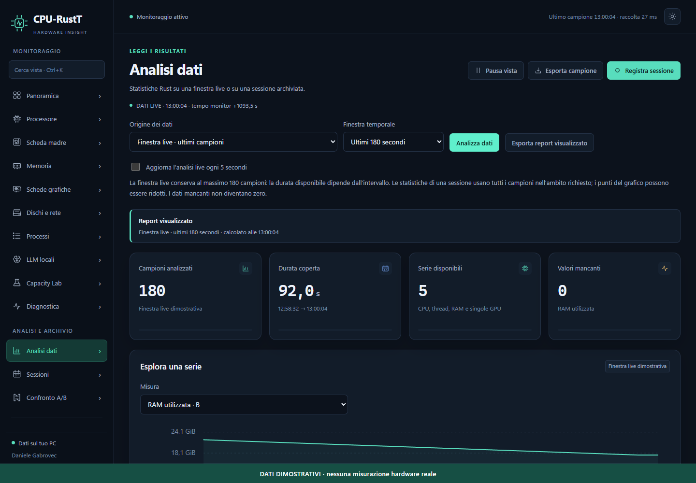

# CPU-RustT

[](https://github.com/danielegabrovec/CPU-RustT/actions/workflows/ci.yml)
[](https://github.com/danielegabrovec/CPU-RustT/releases/latest)
[](LICENSE)

Monitor hardware desktop in italiano: CPU e singoli thread, tutte le GPU,
memoria, processi, dischi e rete. Registra sessioni SQLite, esplora grafici
interattivi, confronta lavori e analizza statistiche e segnali da approfondire.

**Ideazione, struttura e sviluppo: Daniele Gabrovec.**
Copyright © 2026 Daniele Gabrovec. Licenza MIT.

Tauri 2 · Rust · HTML/CSS/JavaScript locali · SQLite incorporato · Windows x64.
Italian desktop hardware monitor with local recording and statistical analysis.



Tutte le immagini usano **dati sintetici dichiarati**. Il repository non contiene
database, eventi o report reali del computer dell'autore.

## Scaricare e avviare

Scaricare da **[GitHub Releases](https://github.com/danielegabrovec/CPU-RustT/releases/latest)**:

| Pacchetto | Uso |
|---|---|
| `CPU-RustT_0.2.0_x64-setup.exe` | Installer per l'utente corrente e menu Start. |
| `CPU-RustT_0.2.0_windows-x64.zip` | Estrarre tutto e aprire `CPU-RustT.exe`. |
| `CPU-RustT.exe` | Eseguibile diretto; licenze consultabili nell'app. |
| `SHA256SUMS.txt` | Impronte dei pacchetti pubblicati. |

Richiede Windows x64 e **Microsoft Edge WebView2**. Non servono Rust, Node.js
o un server SQLite per usare l'app. Se WebView2 manca, l'installer può scaricarlo.
Il setup non è firmato. Linux e macOS non sono target desktop certificati;
la CI verifica separatamente il core Linux.

1. Attendere il primo campione hardware.
2. Esplorare CPU, GPU e processi; i valori assenti restano non disponibili.
3. Premere **Registra sessione** prima di un lavoro e arrestare al termine.
4. Aprire **Analisi dati** o **Confronto A/B** per esaminare la registrazione.

## Novità della versione 0.2.0

- Cerca viste con **Ctrl+K** e apri il primo risultato con **Invio**.
- Cerca sessioni per nome o ID, filtra lo stato e sfoglia pagine da 25 righe.
- Assegna A/B direttamente nell'archivio, scambia i lati e riconosci quando
  il confronto visibile deve essere ricalcolato.
- Ordina i processi dalle intestazioni, anche da tastiera; lo scorrimento
  orizzontale delle tabelle resta conservato durante i refresh.
- Import e chiusura mantengono lo stato incompleto delle registrazioni;
  i contatori incoerenti non producono falsi avvisi di pressione hardware.

## Funzioni

- **14 viste:** panoramica, CPU, scheda madre, RAM, GPU, dischi/rete, processi,
  LLM locali, Capacity Lab, diagnostica, analisi, sessioni, confronto e impostazioni.
- **Grafici esplorabili:** puntatore e tooltip; `Tab`, frecce, `Home` ed `End`
  per la tastiera. Selezione di ogni thread e GPU rilevata.
- **Statistiche Rust:** minimo, massimo, media, mediana, P95, deviazione
  campionaria, delta e dati mancanti, sul live o sulle sessioni archiviate.
- **Problemi e qualità dei dati:** soglie, pressione sulle risorse, spazio ridotto,
  ritardi, valori incoerenti e lettura facoltativa degli eventi Windows.
- **Archivio locale:** replay, confronto, rinomina, import/export JSON e backup.
  Le esportazioni corrispondono alla vista o all'analisi visualizzata.
- **LLM facoltativi:** Ollama, LM Studio e llama.cpp; benchmark soltanto su
  richiesta. Il normale monitoraggio non avvia inferenza.
- **UI:** temi, bozze dei moduli conservate, feedback delle operazioni,
  controlli da tastiera e informazioni su autore e licenze offline.



Altre viste della 0.2: [Archivio sessioni](docs/screenshots/sessions.png) ·
[Processi](docs/screenshots/processes.png) · [Confronto A/B](docs/screenshots/compare.png).

## Misure e dati locali

La CPU dei processi è normalizzata sull'intera macchina. La frequenza OS può
essere nominale. Memoria GPU dedicata e condivisa restano distinte; le misure
assenti non diventano zeri. Sensori e contatori dipendono dai provider disponibili.

Il live conserva **180 campioni**. Le statistiche archiviate usano tutti i
campioni selezionati fino al limite esplicito di **100.000**; i grafici possono
mostrarne **1000**. Media non pesata per tempo, P95 a rango `ceil(0,95 × N)` e
deviazione campionaria `N − 1`: [metodi e guida](docs/ANALISI.md).

Il database è `%LOCALAPPDATA%\it.gabrovec.cpu-rustt\workspace.sqlite3`.
Export e backup sono in Documenti, sotto `CPU-RustT\exports`.
La pausa congela la vista; raccolta e registrazione continuano.

Non sono previsti account, analytics o upload automatici. Le API LLM sono
limitate a origini loopback. Prima di condividere un report controllare nomi
di processi, modelli, volumi, interfacce ed eventi. Nell'archivio la lista dei
processi è limitata a quelli riconosciuti come LLM. [Fonti e limiti](docs/HARDWARE.md).

## Compilare

Rust **1.95+** MSVC, strumenti C++/Windows SDK, Node.js **24+**, PowerShell **7+**
e WebView2. Il motore è incluso in `crates/monitor-core`, senza cartelle esterne.

```powershell
git clone https://github.com/danielegabrovec/CPU-RustT.git
cd CPU-RustT
npm ci
npm run dev
.\scripts\verify.ps1
.\scripts\build.ps1
npm run test:native
```

La CI verifica Windows, frontend con fixture sintetiche e core Linux. Il test
nativo locale resta distinto dalla CI. [Sviluppo](docs/SVILUPPO.md) ·
[Esiti delle prove](docs/VERIFICHE.md) · [Contribuire](CONTRIBUTING.md).

## Documentazione

[Manuale](docs/MANUALE.md) · [Analisi e diagnostica](docs/ANALISI.md) ·
[Hardware](docs/HARDWARE.md) · [Architettura](docs/ARCHITETTURA.md) ·
[Revisione 0.2 e piano](docs/AUDIT-0.2.md) · [Secondo audit](docs/AUDIT-SECONDO-GIRO.md) · [Changelog](CHANGELOG.md) ·
[Autore e licenze](docs/INFORMAZIONI-LEGALI.md).

Codice originale: [MIT](LICENSE). Componenti terzi:
[THIRD-PARTY-NOTICES.txt](THIRD-PARTY-NOTICES.txt).
Autore dell'applicazione: **Daniele Gabrovec**.
